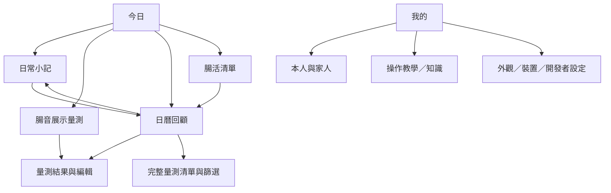

# BowelSound：參考腸note 的日常照護架構

研究日期：2026-10-15。

## 參考依據與界線

參考 Suntory 腸note 的官方公開網站與 Google Play 商店截圖，未登入或操作其完整 APP。

- 官方網站：https://cho-note.com/
- 官方商店：https://play.google.com/store/apps/details?hl=ja&id=jp.co.suntory.global_innovation_center.chonote

公開功能包含腸音量測、排便紀錄、腸活清單與回顧報告。截圖呈現柔和的桃色／綠色、留白、簡短說明與分區資訊。本專案借鑑「記錄 → 行動 → 回顧」的使用流程，採用原創文案、圖示與版面；以下四個分頁是 BowelSound 的改編設計，不宣稱與官方 APP 導覽完全一致。未複製對方 Logo、插畫、腸型分類或評分演算法。

## 使用者看到的資訊架構



| 分頁 | 使用目的 | 畫面層級 |
| --- | --- | --- |
| 今日 | 知道今天能做什麼 | 日期與本人 → 今日狀態卡 → 腸音／排便入口 → 近七日足跡 → 習慣進度 → 最近量測 |
| 日曆 | 回顧某天發生的事 | 對象切換 → 月曆 → 日常小記／習慣 → 當天量測 → 完整清單 |
| 腸活 | 記下自己選擇的日常行動 | 本人與日期 → 完成數 → 三項可取消的打卡 → 知識入口 |
| 我的 | 管理個人偏好 | 本人／家人 → 教學與知識 → 展示裝置 → 外觀 → 本機資料說明 |

## 可運作的第一版範圍

- 本人首頁：只使用已設定本人的紀錄；未設定時引導建立資料。
- 日常小記：依對象與本地日曆日期保存排便情況、主觀感受、備註；可補寫過去，不能寫未來。
- 日曆：切換月份／對象、回到今天；橘點代表小記、藍點代表展示量測、綠點代表習慣。
- 腸活：每日三項預設生活習慣打卡；可取消，進度由實際紀錄計算，不是健康分數。
- 儲存：成功寫入裝置後才更新畫面；載入／寫入失敗會提示，格式錯誤不覆蓋原資料。
- 小記：保留未儲存離開確認；修改小記不改動同日習慣。
- 原有量測、分析、編輯、刪除與篩選路由保留。

## 程式架構

```text
app/(tabs)/index.tsx       今日首頁
app/(tabs)/calendar.tsx    月曆＋每日回顧
app/(tabs)/habits.tsx      今日習慣清單
app/(tabs)/me.tsx          沿用設定頁
app/(tabs)/explore.tsx     量測清單（保留路由，隱藏底部分頁）
app/daily.tsx              日常小記編輯
components/consumer-ui.tsx 共用色票、卡片、按鈕、深色模式
components/wellness-ui.tsx 今日日期、對象選取與入口卡
context/AppContext.tsx    原有個人／量測／設定資料
context/WellnessContext.tsx 新增日常資料載入與儲存
services/wellness.ts       日期、月曆、資料驗證與更新純函式
```

## 資料模型

日常紀錄使用獨立鍵 `@bowelsound_wellness_v1`，格式為 `{ version: 1, entries: DailyEntry[] }`。

`DailyEntry` 欄位：`patientId`、`date`（本地日期 YYYY-MM-DD）、`bowel`、`feeling`、`note`、`habits`、`updatedAt`。

同一對象同一天只有一份小記，更新採局部合併；習慣與備註不會互相覆蓋。`未填寫` 不等於 `今天沒有`。儲存失敗時保留輸入和舊資料，允許重試。舊有三個 AsyncStorage 儲存鍵不變，未修改舊紀錄格式。

跨午夜時首頁與習慣日期會更新，APP 回到前景也會刷新。不同對象使用獨立紀錄；首頁／習慣固定本人，日曆可查看家人。

## 後續擴充邊界

真實錄音與品質判定 → 真實分析 API → 可信的長期趨勢 → 經審閱的內容推薦。

目前不實作腸型分類、健康分數、治療建議或個人化推薦，也不以模擬 AI 結果宣稱健康改善。未新增雲端同步、通知權限或外部資料上傳。

## 驗收入口

`node tests/wellness.cjs` 驗證月份／閏年、日常更新隔離、格式錯誤、未來日期與舊資料保留。

手動流程：設定本人 → 今日小記 → 儲存 → 日曆查看 → 腸活打卡 → 重開頁面確認保留 → 切換家人確認不混用。實機需再檢查大字體、鍵盤、系統返回及跨午夜。
